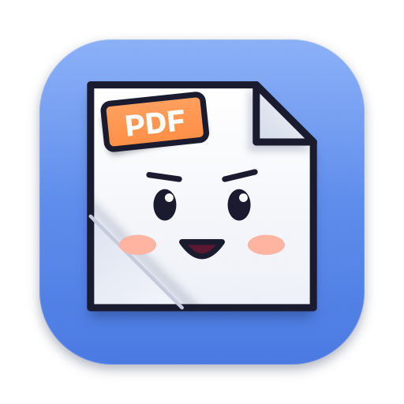

  

<h1 align="center">PDFBoy</h1>

PDFBoy is a small, friendly PDF app for Mac. It finds the blanks on any form, even flat scans with no real fields, so you just click and type; it can fill in your details for you, sign and stamp, shrink big files, combine and split PDFs, and turn them into Markdown. Everything happens on your Mac. This repository is where PDFBoy gets its updates: each release here is offered to every copy of PDFBoy automatically. To get PDFBoy, go to <a href="https://monokern.app">monokern.app</a>.

